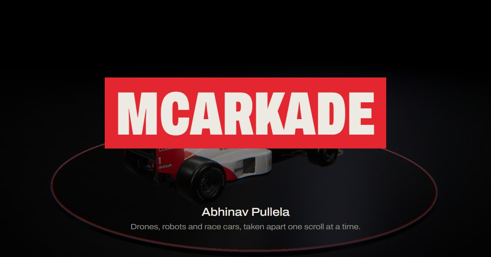

# mcarkade

Abhinav Pullela's portfolio, built as one continuous scroll-driven film.

**Live:** https://mcarkade.vercel.app



## What it is

A dark studio with one light, and the cursor controls it. You scroll through the things I build:

1. **Title sequence.** Frames of my projects flip through the letters of MCARKADE until it slams into a red block, timed to an original score.
2. **The drone.** My F450 quadcopter, modelled part by part in code. It assembles itself, comes apart into its labelled components as you scroll, goes back together, and takes off.
3. **Vision.** The drone flies its mission. It detects a person, brakes and reroutes around them, then locks onto its ArUco marker. The HUD follows the real state machine.
4. **Lock-on.** A counter-drone turret. You fly the drone with your cursor while a PD controller swings the crosshair after it; try to escape. On phones the turret tracks the drone by itself.
5. **The Multiroads garage.** Cars from my browser racing game, each lit as you pass. The McLaren MP4/5 waits on a turntable, explodes into 65 parts, and reassembles.
6. **Launch.** The MP4/5 goes flat out on a procedural road, with a synthesised engine note that follows the speed.
7. **Work, about and contact,** then the car and the drone together for the finale.

Everything is a pure function of scroll position, so the whole film plays backwards exactly. Press `L` for the lights and `M` for sound.

## How it's built

| Part | Approach |
|---|---|
| Rendering | Three.js r186 (WebGL2), ACES tone mapping, PCF shadows from a cursor-driven spotlight, RectAreaLight studio strips, UnrealBloom plus a custom pass for aberration, vignette and radial speed blur |
| Scroll | Lenis smooth scroll. `src/director.js` turns scroll into scene state through keyframe tracks (smootherstep between keys), layered with procedural motion |
| Drone | `src/world/drone.js` models the F450 procedurally: extruded arms, twisted prop blades, A2212 motors, Pixhawk, Pi 4, GPS, battery, wiring. Each part has its own explode vector, delay and tumble |
| Cars | Multiroads GLBs, recompressed with meshopt and WebP textures (25 MB down to 3.4 MB for the MP4/5). The MP4/5 was split into 65 parts with real pivots, so it can explode and roll its wheels |
| Title sequence | `src/intro.js` is a 2D canvas compositor: masked image flips, a pull-back camera, red tint, impact and light sweep, all synced to the audio clock |
| Sound | Score and UI sounds synthesised in Python (`tools/audio/compose.py`, no samples). The engine and prop sounds are live Web Audio synths driven by the scene |
| Performance | Adaptive resolution (drops pixel ratio, then the mirror floor and bloom, if frames run slow); phones fetch the car models only after the drone chapter |
| Mobile | Portrait-aware camera framing, lighter quality tier, touch-safe interactions |
| Accessibility | Semantic sections, skip link, visible focus, reduced-motion path (no intro, no shake), keyboard shortcuts, no-WebGL fallback |

```bash
npm install
npm run dev      # http://localhost:5173
npm run build
```

`node tools/shoot.mjs <url> <outDir> 1440x900 "s:1.36,s:4.6"` captures frames at exact points in the film (section index plus progress). It was used to review every scene during development, and to render the stills used in the title sequence and the social card.

## Made with AI

Built in one night with Claude Code (Opus 5.5) as the lead: design, every scene, shader, keyframe and line of copy. The lead ran a small crew of agents, each with its own folder:

- **Research:** built a dossier of my projects from my own files, and studied Active Theory and Awwwards-winning portfolios.
- **Media:** compressed the car models (split the MP4/5 into animatable parts), photos and video, and traced the model licences.
- **Composer:** wrote and rendered the soundtrack from code, checking loudness, the hit timing and the loop seam by analysis.
- **Audit:** an independent GPT 6.1 Sol pass reviewed bugs, performance, accessibility and responsiveness.

Every change was checked with real GPU screenshots on desktop and phone viewports before it shipped.

## Credits

The car models are third-party works, used under Creative Commons licences for this non-commercial site:

- McLaren MP4/5: vecarz, CC BY 4.0
- Red Bull RB19: vecarz, CC BY-NC-SA 4.0
- Mercedes W11: Tyler_Kevin, CC BY 4.0
- Ferrari F40 (title-sequence still only): Ddiaz Design, CC BY 4.0
- Porsche 911 GT3 (992.2): Ddiaz Design, CC BY-NC-SA 4.0
- Ferrari 488 GT3: Ddiaz Design, CC BY 4.0
- Aston Martin Vantage GT3: OUTPISTON, CC BY-NC-SA 4.0

Source URLs are listed in `public/media/manifest.json`. Fonts: Archivo and Geist Mono (SIL OFL). Everything else, including the drone model, the music and the code, is original.

© 2026 Abhinav Pullela
